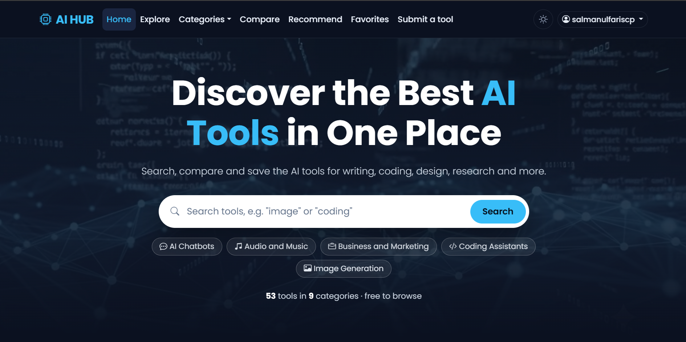
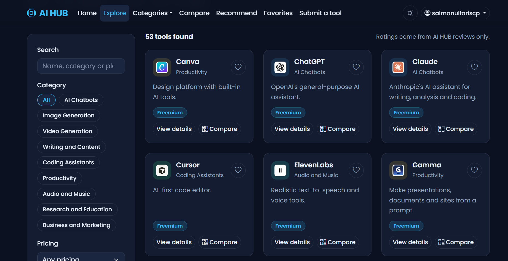
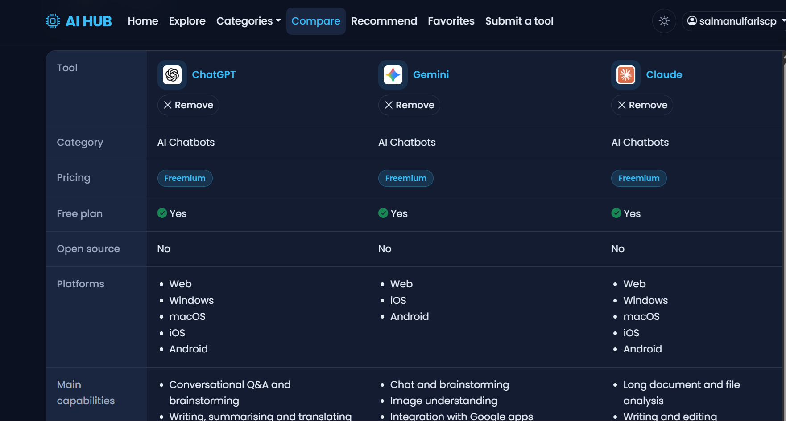

# AI HUB - AI Tools Discovery Platform

A full-stack Django web application where users can **discover, search, compare and save AI tools**.
It started as a static HTML/CSS/Bootstrap directory and was rebuilt with a Django backend, a relational database,
user accounts, reviews, favourites and an admin approval workflow.

**Live demo:** https://salmanulfariscp.pythonanywhere.com
(Hosted on PythonAnywhere's free plan, so the first load can be slow.)

## Screenshots

| Home | Explore |
|---|---|
|  |  |

| Compare | Tool details |
|---|---|
|  |  |

## Features
- **Discover:** 53 AI tools in 9 categories (chatbots, image, video, writing, coding, productivity, audio, research, business).
- **Real-time search** with suggestions, category and pricing filters, open-source filter, sorting and pagination.
- **Compare** two or three tools side by side (pricing, free plan, platforms, features, pros and cons), with a shareable link.
- **Recommendation quiz:** five questions ranked by transparent rules (`apps/tools/recommender.py`), no paid AI API.
- **Accounts:** register, login, logout, password-reset flow, profile and dashboard using Django's built-in authentication.
- **Favourites** (localStorage for guests, database for logged-in users), **collections**, **recently viewed** and **reviews with 1-5 star ratings**.
- **Submit a tool:** validated form with an admin approval queue.
- **Admin:** Django admin to add, edit, delete and feature tools, manage users and hide reviews, plus a staff statistics page.
- **UI:** responsive Bootstrap 5 layout, dark and light themes, skeleton loading, empty states and toast notifications.

## Tech stack
| Area | Technology |
|---|---|
| Backend | Python, Django |
| Database | SQLite (deployed), MySQL-ready configuration via `.env` |
| Frontend | HTML5, CSS3, Bootstrap 5, JavaScript (no framework), Bootstrap Icons |
| Tools | Git, GitHub, PythonAnywhere |

## Database design
- `Category` 1 -> many `Tool`
- `User` <-> `Tool` through `Favorite` (many-to-many with its own table)
- `Tool` 1 -> many `Review`; one review per user per tool
- `User` 1 -> 1 `Profile` (created automatically by a signal)
- `Collection` (user-owned) -> many `Tool`
- `ToolSubmission` -> becomes a `Tool` when an admin approves it

## Project structure
```
config/        settings (reads .env) and root URLs
apps/
  accounts/    Profile, register, profile, dashboard, staff statistics
  tools/       Category, Tool, home/explore/details/compare, recommender, JSON API, seed data
  favorites/   Favorite, Collection, AJAX toggle
  reviews/     Review
  submissions/ ToolSubmission, ContactMessage, NewsletterSubscriber
templates/     base layout, pages, reusable partials
static/        css/, js/ (one file per feature), video/, images/
```

## Run it locally (Windows)
```powershell
python -m venv venv
.\venv\Scripts\Activate.ps1
pip install -r requirements.txt
copy .env.example .env
python manage.py makemigrations accounts tools favorites reviews submissions
python manage.py migrate
python manage.py seed_data
python manage.py createsuperuser
python manage.py runserver 8080
```
Open http://127.0.0.1:8080/ (admin at `/admin/`). On macOS/Linux use `python3` and `source venv/bin/activate`.

If PowerShell blocks the activate script, run `Set-ExecutionPolicy -Scope CurrentUser RemoteSigned` once.

### Using MySQL
```sql
CREATE DATABASE ai_hub CHARACTER SET utf8mb4 COLLATE utf8mb4_unicode_ci;
CREATE USER 'ai_hub_user'@'localhost' IDENTIFIED BY 'choose-a-strong-password';
GRANT ALL PRIVILEGES ON ai_hub.* TO 'ai_hub_user'@'localhost';
```
Then set `DB_ENGINE=mysql` and the `DB_*` values in `.env`, and repeat the migrate and seed commands.
*The MySQL configuration is included but has not been tested in production; the live site uses SQLite.*

## Tests
```bash
python manage.py test            # 11 Django tests: pages, JSON API, favourites, registration, reviews
node tests/test_filters.js       # search / filter / sort / pagination logic
```

## Data notes
- Tool descriptions are short and general. Pricing is only free / freemium / paid, with no prices, ratings or user counts.
- Every seeded tool is marked "unverified" until an admin checks it against the official website and ticks *data verified*.
- "Featured" and "Trending" are editorial flags set by admins, not measured statistics.
- Ratings appear only after real users write reviews.

## Deployment (PythonAnywhere, free plan)
Environment variables (`DJANGO_DEBUG=False`, secret key, allowed hosts, HTTPS) live in a server-side `.env` that is never committed.
Static files are collected with `python manage.py collectstatic`. Free plans cannot send email, so password-reset emails
are not delivered on the live site.

## Known limitations
- Recommendations use simple rules, not machine learning.
- Explore and Compare load the full tool list as JSON, which is fine for hundreds of tools.
- Reviews are published immediately and can be hidden by admins afterwards.
